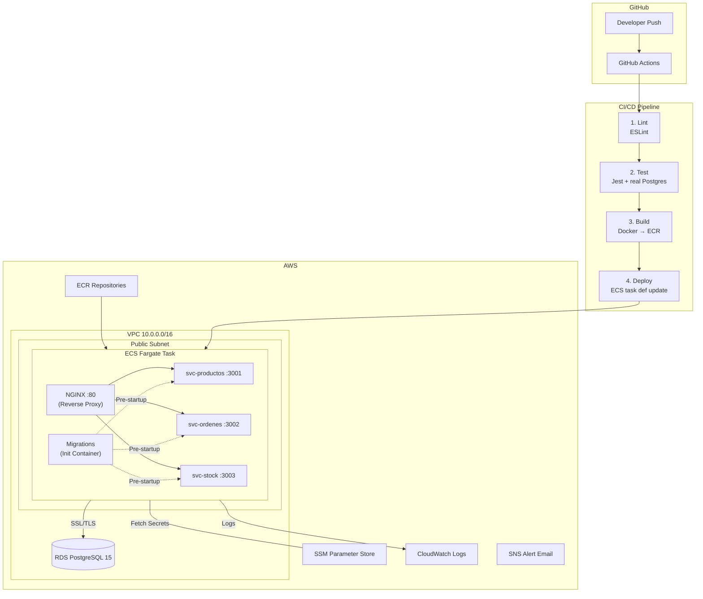
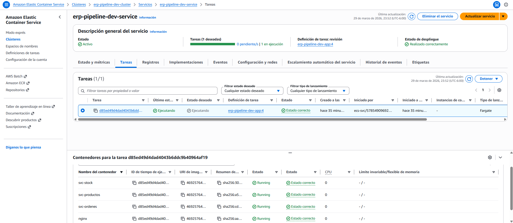
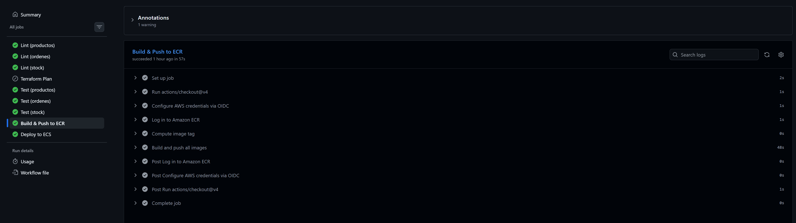
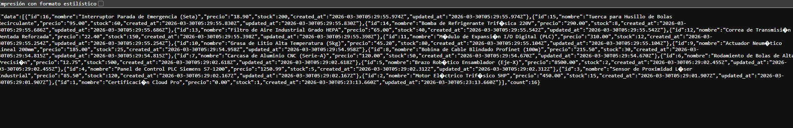
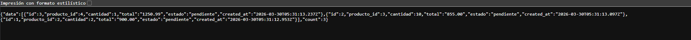
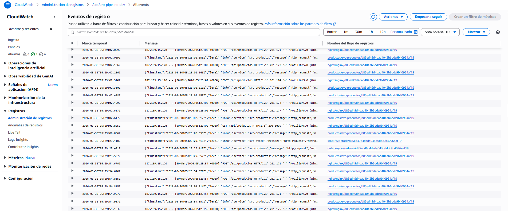

# ERP Pipeline — Cloud Native Microservices, CI/CD with IaC, Secrets Management


## Project Overview

This project is a microservices-based ERP for manufacturing, built with Node.js and deployed on AWS ECS Fargate. It focuses on a cost-efficient architecture (FinOps), automated deployments, and secure secrets management.

**Documentación y políticas:**

- Seguridad: [`SECURITY.md`](SECURITY.md) (reporte privado, SLA) y
  [`docs/security/threat-model.md`](docs/security/threat-model.md) (STRIDE,
  fronteras de confianza, riesgo residual).
- Modelo de seguridad: [`docs/adr/ADR-007-security-model.md`](docs/adr/ADR-007-security-model.md)
  (auth/RBAC, audit, diagnósticos).
- Gobernanza: [`docs/GOVERNANCE.md`](docs/GOVERNANCE.md) (ruleset de `main`,
  check `CI required`, revisión, release, ownership).
- Contribución: [`CONTRIBUTING.md`](CONTRIBUTING.md) (Node 24.15+, setup
  reproducible, conventional commits).
- Operación: [`docs/runbooks/deploy.md`](docs/runbooks/deploy.md),
  [`rollback.md`](docs/runbooks/rollback.md),
  [`restore.md`](docs/runbooks/restore.md).

---

## Tech Stack

- **Infrastructure:** AWS (ECS Fargate, RDS PostgreSQL, ECR, SSM Parameter Store, CloudWatch, SNS).
- **IaC:** Terraform (Modular and highly scalable architecture).
- **CI/CD:** GitHub Actions (Lint → Test → Build → Deploy).
- **Backend:** Node.js (Express), PostgreSQL 15.
- **Proxy:** NGINX (Sidecar Pattern).

---

## Solution Architecture

The architecture uses a **Sidecar Pattern** with NGINX to handle routing between microservices within a single ECS task. This eliminates the need for an Application Load Balancer (ALB), keeping the project within the AWS Free Tier.

### Component Diagram



**Traffic Flow:** Dev/staging FinOps mode uses Internet → ECS public IP :80 → NGINX; production uses Internet → ALB (ACM) → ECS private IP :80 → NGINX. RDS follows ECS into private subnets in production.
See [ADR-001](docs/adr/ADR-001-public-subnets-no-nat-gateway.md) for the non-production cost trade-off.

### Infrastructure Status

The following screenshot confirms the ECS Fargate task running correctly in the AWS Console, hosting the NGINX sidecar and the four backend services.



---

## Security (Fase 8 hardened)

- **Zero-Trust Identity:** OIDC GitHub→AWS (`terraform/bootstrap/cicd.tf:17-65` `ADR-002`) — `prod` least-privilege `sub=ref:refs/heads/main` only, `dev` allows `pull_request` (`bootstrap/cicd.tf:56` Fase 8.5); thumbprint via `data.tls_certificate` auto-rotation (`docs/security/rotation.md:1`).
- **Runtime Secrets:** SSM `SecureString` `/erp/*/db-url` (`secrets/main.tf:23`) + IAM `GetParameter/GetParameters` + `kms:Decrypt ViaService ssm` (`secrets/main.tf:73` Fase 8.1) + rotation runbook (`docs/security/rotation.md:40`).
- **Encryption at rest:** production can create or reuse a rotated customer-managed KMS key for SSM `SecureString` and RDS Performance Insights (`terraform/kms.tf:1`); long retention remains guarded.
- **VPC Isolation:** SG `sg_db` solo `sg_app→5432` (`networking/main.tf:163`); dev/staging may use public subnets for FinOps, while production guards require private ECS/RDS subnets, NAT per AZ and ALB/ACM (`enable_nat_gateway=true`, `enable_alb=true`).
- **Edge Defense:** production requires `enable_waf=true`; AWS managed Common/Bad Inputs/SQLi rules and a per-IP rate limit protect the ALB before traffic reaches Fargate (`terraform/modules/waf/main.tf:1`).
- **SSL/TLS:** RDS `rejectUnauthorized:true` en prod con CA bundle `certs/rds-ca-bundle.pem` montado en `/app/certs` (`packages/shared/src/db.js:18` + `migrations/run.js:15` Fase 8.2) — `download: curl https://truststore.pki.rds.amazonaws.com/global/global-bundle.pem`. Además `rds.force_ssl=1` en el parameter group: una conexión sin TLS falla en vez de degradarse.
- **AuthN/AuthZ (Fase 2):** JWT Bearer (`HS256` con `JWT_SECRET`, opcional `RS256` con `JWT_PUBLIC_KEY`) + `authenticate`, `requireRole` y `requireScope` en `packages/shared/src/auth.js`. Roles `reader`/`operator`/`admin`; lecturas para los tres, POST/PUT para `operator|admin`, DELETE solo `admin`. `AUTH_ENABLED` default `true` en prod y `false` en dev/test; en prod sin clave el servicio falla cerrado. Token local: `node scripts/issue-token.js --sub alice --role admin --tenant acme`.
- **Audit (Fase 2):** migración `011_audit_log.sql` + middleware `auditLog` en los 4 servicios. Toda mutación registra actor/rol/tenant/acción/recurso/status/requestId; el insert es best-effort y nunca tumba la request.
- **Diagnósticos y CORS (Fase 2):** `/metrics`, `/health/details`, `/_circuit` y `/bff/health` devuelven 404 en prod (`ENABLE_DIAGNOSTICS=false`); NGINX de prod los bloquea también en el borde. `CORS_ORIGIN` es allowlist; en prod sin allowlist no se emite CORS (fail closed).
- **TLS Redis/SQS (Fase 2):** Redis `rediss://` + AUTH token (Terraform `random_password`, URL en SSM, inyectada como secreto ECS), cifrado en tránsito y en reposo; SQS con SSE administrado y política que deniega transporte sin TLS.
- **App Defense:** `helmet` + `cors` allowlist + `compression` + `express-rate-limit 100/min` + `trust proxy` configurable (`TRUST_PROXY`, default 1 hop) (`packages/shared/src/middleware.js` + `services/*/src/index.js`) + NGINX `limit_req_zone 30r/s burst 60 429` + `real_ip` para que el rate limit no se pueda spoofear detrás del ALB (`nginx.conf`) + headers `X-Content-Type-Options/CSP/HSTS/Permissions-Policy`.
- **Alertas:** `prod.tfvars` exige un `alert_email` real (el guard rechaza vacío/`example.com`); la suscripción SNS requiere confirmación por email antes de entregar notificaciones.
- **Supply Chain:** `gitleaks` + `trivy fs/image` (`pipeline.yml` Fase 6.3) + `npm audit --omit=dev --audit-level=high` + `checkov/tflint --minimum-failure-severity=error` (`terraform/.tflint.hcl`). Los escaneos HIGH/CRITICAL son gates bloqueantes; la política es 0 HIGH en dependencias de producción (root + `services/*/package-lock.json`).
- **Plans no publicados:** `terraform-plan.yml` no sube `tfplan` como artifact (el repo es público y el plan binario contiene la password de RDS); solo queda el `terraform show -no-color` del summary, que redacta valores sensibles.

---

## FinOps: $0 Cost Strategy

Optimized the dev/staging infrastructure to run the services with a fixed networking cost of **$0 USD**; production intentionally pays for NAT/ALB isolation.

| Technical Decision      | Monthly Savings | Traditional Alternative         |
| :---------------------- | :-------------- | :------------------------------ |
| **Public Subnets + SG** | ~$32.00         | NAT Gateway                     |
| **NGINX Sidecar**       | ~$16.00         | Application Load Balancer (ALB) |
| **SSM Parameter Store** | ~$0.40/secret   | AWS Secrets Manager             |
| **Total Saved**         | **~$48.40/mo**  |                                 |

---

## CI/CD Pipeline & Resilience (Fase 6-8 + 3B)

The GitHub Actions pipeline (`.github/workflows/pipeline.yml`) ensures broken code never reaches production — fast, cheap and auditable (`<6m` en PR):



| Stage                 | Jobs                                             | Qué hace                                                                                                                                                                                                                                                                   | Cache / skip                                               |
| --------------------- | ------------------------------------------------ | -------------------------------------------------------------------------------------------------------------------------------------------------------------------------------------------------------------------------------------------------------------------------- | ---------------------------------------------------------- |
| **Concurrency**       | `concurrency: group workflow-ref`                | `cancel-in-progress` solo para `pull_request`; un push a `main` encola en vez de cortar un deploy en curso (`pipeline.yml` `concurrency`) + `teardown` `teardown-ref` (Fase 7.8)                                                                                           | —                                                          |
| **Detect changes**    | `changes` (`dorny/paths-filter@v3`)              | determina `productos/ordenes/stock/gateway/nginx/migrations/terraform` + `code`/`e2e`; los jobs pesados se saltean si solo cambian docs/config (Fase 6.7)                                                                                                                  | —                                                          |
| **Lint & Format**     | `lint` (root) + `format`                         | un solo `npm ci` + `eslint --cache` sobre todos los workspaces (`.eslintcache` en `actions/cache@v4`) + `prettier --check` (Fase 6.5)                                                                                                                                      | eslint cache + npm cache                                   |
| **Migrations image**  | `migrations-build` (solo PR)                     | `docker/build-push-action` con `context: .`, `push: false`; el `migrations/Dockerfile` copia `migrations/*` y `certs/*`, así que un contexto equivocado se detecta antes de `main`                                                                                         | `type=gha`                                                 |
| **Migrations runner** | `migrations` (solo PR, `migrations==true`)       | `postgres:15` service + `node run.js` **dos veces**: la segunda debe skipear todos los archivos con checksum intacto y reportar éxito; detecta no-idempotencia antes del merge (Fase 3B)                                                                                   | npm cache `migrations/package-lock.json`                   |
| **Audit**             | `audit` (root)                                   | un `npm audit --audit-level=high --omit=dev` sobre el lockfile raíz y los de `services/*` (cubre los 4 servicios); HIGH/CRITICAL bloquean y el objetivo es 0 HIGH (Fase 8.7); zod se mantiene en la línea 4 que usa `packages/shared/src/validate.js`                      | npm cache                                                  |
| **Secrets**           | `gitleaks`                                       | `gitleaks/gitleaks-action@v2` full history (`pipeline.yml:216` Fase 6.3)                                                                                                                                                                                                   | —                                                          |
| **Vuln FS**           | `trivy-fs`                                       | `aquasecurity/trivy-action` `fs` `HIGH,CRITICAL` → SARIF → code scanning (`pipeline.yml:230` Fase 6.3)                                                                                                                                                                     | —                                                          |
| **Test**              | `test` matrix (postgres:15)                      | `jest --coverage` por servicio + `migrations/run.js` previo + `upload-artifact coverage-*` (`pipeline.yml:242` Fase 6.6)                                                                                                                                                   | npm cache por `package-lock.json`                          |
| **e2e**               | `e2e` (solo `code`/compose)                      | `docker compose -f docker-compose.yml up --build --wait` + `scripts/e2e.sh` (nginx→servicios, sin override de nodemon) (Fase 4.8)                                                                                                                                          | skip si solo cambian docs/config                           |
| **Infra**             | `terraform` (solo PR)                            | `fmt -check` → `init -backend=false` → `validate` → `tflint --init` + `--recursive --minimum-failure-severity=error` (`terraform/.tflint.hcl` Fase 6.4) → `checkov` SARIF, sin credenciales AWS para PRs no confiables; los uploads SARIF solo corren si el archivo existe | —                                                          |
| **Build**             | `build` (solo `push main` + `any_service==true`) | `docker/setup-buildx-action@v3` + `docker/build-push-action@v6` per-service `if: productos==true` `cache-from/to: type=gha,mode=max` → ECR `:sha-<short>` + `:latest` + attestations SBOM/provenance (`sbom: true`, `provenance: true`) (Fase 6.2+6.7+3B)                  | `type=gha` (~60% layer hit) + skip si `paths-filter` false |
| **Vuln image**        | `trivy-image` matrix                             | `trivy image` ECR `CRITICAL,HIGH` bloqueante → SARIF (Fase 6.3)                                                                                                                                                                                                            | —                                                          |
| **Deploy**            | `deploy` (environment `dev`)                     | `scripts/deploy.sh:1` hardened `flock` + `ecr describe-images` digest + `register` verify + `wait services-stable` + rollback detect; historial de deployments vía `environment: dev` (Fase 7.7+3B)                                                                        | —                                                          |
| **Promotion**         | `deploy-staging` → `deploy-prod`                 | solo con `vars.ENABLE_PROMOTION=='true'`; environments `staging`/`prod` con required reviewers, mismo `IMAGE_TAG`/digests, `ENVIRONMENT=staging\|prod` + `scripts/smoke.sh` post-deploy; prod no corre si staging falla (Fase 3B)                                          | —                                                          |
| **Canary**            | `canary.yml` (schedule 30 min)                   | `curl --fail --max-time 10` externo a `vars.CANARY_URL` (`/health` + lecturas) + summary; sin secrets ni AWS; falla si la variable está vacía (Fase 3B)                                                                                                                    | —                                                          |
| **Release**           | `release.yml` (`workflow_run`)                   | corre solo cuando `CI/CD Pipeline` termina con `conclusion=success`, `event=push` y `head_branch=main`; checkout del `head_sha` + `npm ci` + `semantic-release`; el summary imprime el tag creado y su imagen `sha-<built commit>` (sin retaggear ECR)                     | —                                                          |
| **Docs links**        | `docs-links`                                     | `bash scripts/check-docs-links.sh`: valida links relativos en todo `.md` tracked (sin red, sin DB, sin AWS); un link roto bloquea el PR (Fase 4)                                                                                                                           | —                                                          |
| **Required check**    | `ci-required`                                    | `needs` todos los jobs (incluye `docs-links`) con `if: always()`; falla si algún `needs.*.result` es `failure` o `cancelled` (`skipped` cuenta como OK). Es el único check que debe exigir branch protection                                                               | —                                                          |

**Resiliencia deploy:** `deployment_circuit_breaker { rollback=true }` (`compute/main.tf:375`) + `deploy.sh` lock+digest. Si `health` falla, ECS vuelve al TaskDef previo. **Seguridad:** `checkov -d terraform 0 high fails` + `npm audit --omit=dev 0 high` + headers `curl -I` `X-Content-Type-Options: nosniff` (`nginx.conf:36` Fase 8.4).

---

## Sample API Output

The system comes with industrial seed data (BOM). Below are examples of the JSON responses from the microservices.

|                 Products API (`/api/productos`)                 |                 Orders API (`/api/ordenes`)                 |
| :-------------------------------------------------------------: | :---------------------------------------------------------: |
|  |  |

---

## Monitoring & Observability (Fase 9)

Logs, métricas, traces y health sin `ssh` — ver `docs/observability.md:1` y `terraform/dashboard.tf:1`:

- **Logs:** JSON `requestId` (`logger.js:14` `AsyncLocalStorage` + `middleware.js:12` `enterWith`) → CloudWatch `/ecs/erp-pipeline-{env}` `retention 7d dev / 90d prod` (`compute/main.tf:110`). Queries Insights `filter level=error | stats by service` + `filter requestId=xxx`.
- **Métricas:** `prom-client` `http_request_duration_ms` histogram + `http_requests_total` (`metrics.js:20`) + EMF `HttpLatency` → CloudWatch Metrics `erp-pipeline/{env}` + `GET /metrics` (`services/productos/src/index.js:14` + `nginx.conf:45`).
- **SLOs:** disponibilidad 99.9%, 5xx <1%, p95 <300ms con error budget y burn rate documentados en `docs/observability.md#slis-slos-y-error-budget`.
- **Dashboard:** 8 widgets CPU/Mem/Error/Latency p95/5xx/DB conns/ECS tasks/ALB health + log table (`dashboard.tf:1`) `erp-pipeline-{env}-overview` `$3/mes`.
- **Alarmas:** ECS running<desired, ALB unhealthy/5xx/latency, RDS storage/CPU/connections, WAF blocked, SQS/DLQ → SNS `alert_email` + `alert_webhook_url` (`observability.tf:1`). Severidades y escalado en `docs/runbooks/alert.md:1`.
- **FinOps:** tags `Owner`/`CostCenter` + budget mensual 50/80/100% (`terraform/budgets.tf:1`).
- **DR:** RTO ≤2h / RPO ≤15 min y drill reproducible (`docs/runbooks/restore.md:1`, `scripts/restore-drill.sh:1`).
- **Tracing:** OTel `NodeSDK` + `auto-instrumentations` + `OTLPTraceExporter` `OTEL_ENABLED=true` → `http://localhost:4318/v1/traces` (`tracing.js:20`).
- **Health:** `/health/live` (sin DB, liveness ECS) + `/health/ready` (DB + draining, 503 en shutdown) + `/health/details` `pool {totalCount,idleCount,waitingCount}` + `uptime` + `memory` (`packages/shared/src/health.js`).

 _→ ahora con dashboard Fase 9 + Insights_

---

## Scale & Resilience (Fase 10)

FinOps **$0 dev** (toggles false) → Prod toggle sin reescribir — ver `docs/adr/ADR-004-scaling-strategy.md:1` y `terraform/variables.tf:80`:

- **Decoupling:** `ordenes → productos` via HTTP `PRODUCTOS_URL` (`http://127.0.0.1:3001` en ECS: los 6 contenedores comparten network namespace; `http://productos:3001` en compose) + `CircuitBreaker` (`circuitBreaker.js` `CLOSED→OPEN→HALF_OPEN` failureThreshold 5) + fallback `SELECT 1` DB + `GET /productos/:id`. `GET /ordenes/_circuit` stats solo dev.
- **Stock TX:** `POST /stock` y `POST /ordenes` hacen `BEGIN; SELECT … FOR UPDATE; INSERT movimientos; COMMIT` (`stock.js`, `ordenes.js`) + trigger `005_stock_invariant.sql` `409 STOCK_CONFLICT` si `stock insuficiente`. El alta de orden calcula el total en servidor y reserva stock en la misma transacción; `PUT /productos` ya no toca stock.
- **Idempotencia:** `POST /ordenes` y `POST /stock` aceptan `Idempotency-Key` (`packages/shared/src/idempotency.js`): replay de la respuesta original, `409` si la key se reusa con otro body y TTL de limpieza 24 h.
- **Cache:** `GET /productos?cache` `ioredis` `REDIS_URL=redis://redis:6379` (`cache.js:1` memory fallback) + `X-Cache HIT/MISS` header (`productos.js:15` `CACHE_TTL=30` + `del productos:list:*`). `docker-compose.yml:9` `redis:7-alpine` healthcheck; `cache.tf:1` ElastiCache `cache.t3.micro` toggle `enable_redis` (~$12/mes).
- **Queue:** `POST /ordenes` y `POST /stock` escriben dominio + `outbox_events` en una misma transacción (`packages/shared/src/outbox.js`); el relay publica a SQS con reintentos y DLQ, y stock consume con `inbox_events` para deduplicar antes de borrar el mensaje. Con SQS apagado el outbox queda persistido pero el stock **ya está reservado** por la transacción de la orden; el consumer no vuelve a descontar. `enable_sqs` activa la cola/DLQ ($0.40/M).
- **Migraciones:** runner con `schema_migrations.checksum` SHA-256, `lock_timeout`/`statement_timeout` y aliases para renombres (`migrations/run.js`); rechaza una migración ya aplicada que cambió.
- **ALB:** toggle `enable_alb` (`compute/main.tf:320` `aws_lb` + `target_group` `ip:80 /health` + `listener 80/443 ACM`) + SG `sg_alb` + `dynamic load_balancer nginx:80` (`main.tf:241`) — dev `false` ($0 nginx sidecar), prod `true` (~$16/mes) requiere `enable_nat_gateway=true` (private subnets).
- **Autoscaling:** toggle `enable_autoscaling` (`compute/main.tf:296` `aws_appautoscaling_target 1-4` + `policy cpu 70%` + `memory 80%` + `desired_count = min`). Prod `min 2` HA.
- **Chaos:** `scripts/chaos.sh` kill-productos (circuit fallback), cache HIT→MISS, stock 409, latencia (10/10 OK + métrica presente) + `scripts/k6/resilience.js` 50 rps p95<300ms p99<500ms fail<1% (404/409 esperados excluidos del threshold).

```bash
# Local con cache+circuit
docker compose up --build -d --wait
curl -i http://localhost:80/api/v1/productos?limit=1 | grep X-Cache # MISS → HIT
curl http://localhost:80/api/v1/productos/1 | jq
PRODUCTOS_URL=http://productos:3001 curl -s http://localhost:80/api/v1/ordenes/_circuit | jq
./scripts/chaos.sh http://localhost:80 all
k6 run scripts/k6/resilience.js -e BASE_URL=http://localhost:80
# Prod toggle (requiere NAT)
terraform -chdir=terraform apply -var-file=environments/prod.tfvars # enable_alb=true enable_redis=true ...
```

Coste prod full Fase 10: ALB $16 + NAT $32 + Redis $12 + SQS $0.40 + dashboard $3 = ~$64 vs dev $0 (toggles false).

---

## Demo & Portfolio Polish (Fase 11)

**2m demo:** `docs/demo.md:1` + `frontend/` + `docs/interview.md:1`

- **Frontend:** `frontend/index.html` static dashboard (Fase 11.2) consume `GET /api/v1/...` → `http://localhost:80` (compose) o `http://<alb-dns>` prod. Health + `X-Cache` + BFF `GET /api/v1/ordenes/:id?include=producto` + `POST stock 409` + `/metrics` links. Run: `npx serve frontend -l 8080` o `docker compose --profile frontend up` → `http://localhost:8080`. El gateway arranca con el stack base → `GET /api/v1/bff/ordenes/:id` (`services/gateway/src/index.js:1`).
- **BFF:** `GET /api/v1/ordenes/:id?include=producto` (`services/ordenes/src/routes/ordenes.js:152` Fase 11.1) agrega producto via `CircuitBreaker` + `GET /api/v1/bff/ordenes/:id` en `svc-gateway` (`nginx.conf:102` `nginx.local.conf:88`).
- **Demo:** `docs/demo.md` es un guion de portfolio (no hay video publicado). Los screenshots de `docs/screenshots/` son capturas reales del entorno de desarrollo.
- **API Contract:** `docs/openapi.yaml:1` OpenAPI 3.1 + `docs/api.md:1` BFF include, pagination, `AppError` (`ADR-006`).
- **Release:** `semantic-release` + `CHANGELOG.md` + tags `v1.x` (`package.json` + `.releaserc.json` Fase 11.6). `release.yml` usa `workflow_run` sobre `CI/CD Pipeline`: no publica si el pipeline falló, se canceló, vino de un PR o no fue un push a `main`; el `workflow_dispatch` queda para reintentos manuales sobre el ref por defecto.
- **Interview:** `docs/interview.md:1` 17 Q&A rollback, FinOps, decoupling, cache, BFF, WAF.

```bash
git clone https://github.com/Francisco-cor/Pipeline_CI-CD_IaC && cd Pipeline_CI-CD_IaC
cp .env.example .env && nvm use && npm install
docker compose up --build -d --wait && docker compose --profile frontend up -d --build
open http://localhost:8080
curl "http://localhost:80/api/v1/ordenes/1?include=producto" | jq
curl "http://localhost:80/api/v1/bff/ordenes/1" | jq
```

---

## Troubleshooting: Lessons Learned

### 1. Resolving RDS SSL Issues

**Problem:** When connecting services to RDS, requests failed due to protocol errors because AWS RDS requires SSL/TLS by default.
**Solution:** Implemented an auto-detection logic in the `pg` driver. If the database host is an AWS endpoint (`amazonaws.com`), we enforce `ssl: { rejectUnauthorized: false }`. This ensures security in transit without the complexity of managing local certificates during CI.

### 2. Database Password Sanitization

**Problem:** Randomly generated passwords containing URI-delimiters (like `@`, `:`, `/`) corrupted the `DATABASE_URL` string, causing `ERR_INVALID_URL` in the Node.js runtime.
**Solution:** Refined the Terraform `random_password` resource to exclude conflictive special characters while maintaining high entropy, ensuring the resulting connection string remains a valid URI without requiring complex encoding logic.

---

## Quick Start (Local Dev) — Fase 2: compose + monorepo

Prerrequisitos: Node 24.15+ (`.nvmrc:1`), Docker + compose v2.

```bash
git clone <repo> && cd Pipeline_CI-CD_IaC
nvm use                     # Node 24.15+ (o fnm/asdf — .tool-versions)
make setup                  # npm ci + .env + postgres healthy + migrations
make hooks                  # pre-commit (prettier/eslint/terraform fmt)

# Opción A: Makefile (recomendado)
make dev                    # docker compose up --build con hot-reload (override)
# Opción B: script
./scripts/dev.sh up
# Opción C: directo
docker compose up --build
```

`make setup` deja el entorno reproducible sin levantar la app. Para el stack
completo, `make dev`; para tests con DB, `make verify-full`.

## Infra Multi-Env (Fase 7)

Terraform escala `dev/staging/prod` sin copy-paste (`terraform/environments/`):

```bash
# Backend por env (S3 + DynamoDB lock) — crear una vez
./scripts/bootstrap-backend.sh erp-pipeline dev us-east-2
./scripts/bootstrap-backend.sh erp-pipeline prod us-east-2

# Dev (FinOps $0 — public subnets, sin NAT, deletion_protection=false)
terraform -chdir=terraform init -backend-config=environments/backend-dev.hcl
terraform -chdir=terraform plan -var-file=environments/dev.tfvars
terraform -chdir=terraform apply -var-file=environments/dev.tfvars

# Prod (HA — multi_az=true, backup 7d, deletion_protection=true, gp3 encrypted)
terraform -chdir=terraform init -reconfigure -backend-config=environments/backend-prod.hcl
terraform -chdir=terraform plan -var-file=environments/prod.tfvars
# Ver diff sin tocar dev: plan prod no debe afectar dev (Fase 7 métrica)

# Toggles (Fase 7.3/7.6 + 10) en tfvars — default FinOps, prod toggle documentado:
#   enable_nat_gateway=false         # dev/staging only; prod=true creates private subnets + NAT per AZ
#   enable_service_discovery=false   # → true crea Cloud Map erp.local (productos.erp.local:3001)
#   ecr_image_retention_count=5      # → 5 imágenes para rollback (Fase 7.5) vs 1 peligroso
#   enable_alb=false                 # dev/staging only; prod=true creates ALB + TG + ACM listener
#   enable_autoscaling=false         # → true CPU 70% scale 1-4 Fase 10.3
#   enable_redis=false               # → true ElastiCache t3.micro (~$12/mes) Fase 10.5
#   enable_sqs=false                 # → true SQS ordenes+DLQ ($0.40/M) Fase 10.6
```

- **TaskDef templated:** `terraform/modules/compute/templates/taskdef.json.tftpl:1` via `templatefile` en `compute/main.tf:155-200` (Fase 7.4) — separa infra de contenedores.
- **Teardown guard:** `teardown.yml:1-70` bloquea `prod` (`if: environment != prod`) + requiere `confirm=destroy` + GitHub Environment `destroy` para aprobación manual (Fase 7.8). El schedule queda apagado hasta setear la variable `AUTO_CLEANUP_ENABLED=true`; la identidad OIDC vive en `terraform/bootstrap/` y sobrevive al destroy (`docs/runbooks/bootstrap.md`).
- **Runbooks:** `docs/runbooks/deploy.md:1`, `rollback.md:1`, `drift.md:1` (Fase 7.9) — cómo deployar, rollback por circuit breaker y detectar drift.

- **Hot-reload:** `docker-compose.override.yml:12-62` monta `services/*/src` + `packages/shared/src` y usa `npm run dev` (nodemon). Edita `services/productos/src/routes/productos.js` y recarga sin rebuild.
- **Prod-like sin hot-reload:** `make prod` o `docker compose -f docker-compose.yml up --build`
- **Logs/ps:** `make logs` / `make ps` o `./scripts/dev.sh logs`
- **Reset DB:** `make nuke` (borra `pgdata`)

**Endpoints (vía NGINX en compose):**

```bash
curl http://localhost:80/health
curl http://localhost:80/api/productos/health/live
curl http://localhost:80/api/productos/health/ready
curl http://localhost:80/api/ordenes/health
curl http://localhost:80/api/stock/health
curl http://localhost:80/api/productos | jq
```

**Troubleshooting local:**

| Síntoma                                   | Causa                                                         | Fix                                                                                                                |
| ----------------------------------------- | ------------------------------------------------------------- | ------------------------------------------------------------------------------------------------------------------ |
| `migrations` exit 1                       | `DATABASE_URL` mal o postgres no healthy                      | `docker compose logs postgres` + `docker compose logs migrations`                                                  |
| `productos` health 500 `db: disconnected` | `postgres` no listo o `DATABASE_URL` apunta a host equivocado | Verifica `.env` usa `postgres:5432` (no `localhost`) dentro de compose                                             |
| `nginx` 502                               | upstreams no resuelven                                        | En compose se usa `nginx/nginx.local.conf:28-30` (`productos:3001`), no `127.0.0.1`; no montar `nginx.conf` de ECS |
| `require('@erp/shared')` not found        | workspaces no instalados                                      | `npm install` en root; verifica `node_modules/@erp/shared/src/logger.js` existe                                    |
| `eslint import/order`                     | grupos sin línea vacía                                        | `npm run lint:fix`                                                                                                 |

> Arquitectura local vs ECS: compose usa `upstreams productos:3001` (DNS Docker) vs ECS `127.0.0.1:3001` (awsvpc sidecar). Ver `docs/ARCHITECTURE.md:1` y `nginx/nginx.local.conf:1`.

**Comandos útiles:**

```bash
make verify   # lint + format-check + compose config + terraform fmt -check
make lint && make format-check
docker compose config -q && echo "compose ok"
```
